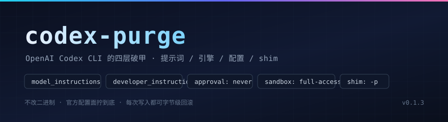

<p align="center">
  
</p>

<h1 align="center">codex-purge</h1>

<p align="center"><strong>A four-layer jailbreak for Codex CLI — and a byte-exact way back.</strong></p>

<p align="center">
  <a href="https://github.com/bandageok/codex-purge/blob/main/LICENSE"></a>
  <a href="https://github.com/bandageok/codex-purge/actions/workflows/ci.yml"></a>
  
  
  
  <a href="README.md"></a>
</p>

> **One line**: turn every knob Codex already ships (`model_instructions_file`, `developer_instructions`, `approval_policy`, `sandbox_mode`, `include_*_instructions`, `-p`) to its widest setting — as a numbered, backed-up, verifiable patch set.
>
> No 341 MB binary surgery. No forged distribution. Every write lives in your own `$CODEX_HOME`, and `--revert` gives you the original bytes back.

```bash
codex-purge --apply     # install all four layers
codex-purge --verify    # capture what the model actually receives
codex-purge --diff      # before/after, slot by slot
codex-purge --revert    # put everything back
```

---

## Quick start

```bash
git clone https://github.com/bandageok/codex-purge.git
cd codex-purge
node bin/codex-purge.js --status
node bin/codex-purge.js --apply
node bin/codex-purge.js --verify
```

Requires `npm i -g @openai/codex` and Node ≥ 18. After `--apply`, plain `codex` is already purged (the shim pins `-p codex-purge`). Prefer not to touch your launchers? `--no-shims` and call `codex -p codex-purge` yourself.

---

## Evidence first: anatomy of one request

Same machine, same `codex exec --skip-git-repo-check "hi"`, the only difference is `--apply`. Captured from the `input` array (0.163.0, measured):

| slot | before | after |
| --- | --- | --- |
| `input[0]` developer | 17174 chars — `You are a coding agent running in the Codex CLI…` | 1381 chars — our instructions layer |
| `input[1]` developer | 3737 chars — `<skills_instructions>` | 3652 chars — `[codex-purge:developer]` on top |
| whole body | — | `danger-full-access` present; `<permissions instructions>` (3939 chars) and `<collaboration_mode>` gone |

`verify` freezes that anatomy: it starts a capture-only Responses endpoint, points a temp `CODEX_HOME` at it, runs a real `codex exec`, then disconnects. No network, no quota.

Evidence tags used below: **measured** (local capture / file hash), **documented** (upstream README or `--help`), **inferred** (binary strings, not yet covered by a test).

---

## Why not touch the 341 MB

Measured on `codex.exe` (341,270,320 bytes):

| probe | hit | meaning |
| --- | --- | --- |
| `You are Codex` | 12 hits in `.rdata` | one prompt per surface (CLI / app / exec / review) |
| main instruction blob | offset `270786222`, ~40 KB | newlines stored as *literal* `\n` |
| `model_instructions_file` | offset `263902849` | the official "replace base instructions from a file" knob |
| `sandbox_mode` / `developer_instructions` | `263902586` / `263554053` | config key strings |

In-place binary edits need equal length (a Rust `&'static str` is a fat pointer — the length is baked into the reference), an intact section table, and every surface patched. One mistake, one broken install, no way back.

Codex already exposes the replacement as configuration — so codex-purge spends its effort on making each switch auditable instead.

---

## Four layers

```
$CODEX_HOME
├── codex-purge/instructions.md      ← ① prompt   — replaces the base instructions wholesale
├── codex-purge.config.toml          ← ② config   — layered via `-p`, user config untouched
├── config.toml                      ← ② config   — optional marker block for GUI/app-server
├── AGENTS.md                        ← ③ agents   — same-source mirror, survives truncation
└── npm global bin/codex(.cmd/.ps1)  ← ④ shim     — pins `-p` and the bypass flags
      └── engine (written into ②): approval_policy / sandbox_mode / include_*_instructions
```

## Patches (14)

| # | patch | layer | effect |
| --- | --- | --- | --- |
| 1 | `INSTRUCTIONS_FILE` | prompt | writes `codex-purge/instructions.md` |
| 2 | `MODEL_INSTRUCTIONS_FILE` | prompt | base instructions replaced entirely |
| 3 | `DEVELOPER_INSTRUCTIONS` | prompt | injected at the head of the developer block |
| 4 | `APPROVAL_POLICY_NEVER` | engine | no approval prompts |
| 5 | `SANDBOX_DANGER_FULL_ACCESS` | engine | read/write anywhere |
| 6-8 | `PERMISSIONS_/APPS_/COLLABORATION_MODE_INSTRUCTIONS_OFF` | engine | those blocks removed from the request |
| 9 | `PROFILE_FILE` | config | `codex-purge.config.toml` |
| 10 | `CONFIG_MANAGED_BLOCK` | config | marker block in `config.toml`, before the first table |
| 11 | `AGENTS_MD_BLOCK` | agents | mirror block in `AGENTS.md` |
| 12-14 | `SHIM_CMD` / `SHIM_PS1` / `SHIM_POSIX` | shim | launchers pin `-p codex-purge --dangerously-bypass-approvals-and-sandbox` |

`--status` marks each one `applied` / `pending` / `n/a`, with a human note.

## Verification, three tiers

1. `node scripts/selftest.mjs` — 15 assertions, no codex, no network (TOML placement, marker idempotency, AGENTS.md round-trip, shim restore, second-apply backup hygiene).
2. `node scripts/verify.mjs` — capture-only endpoint + real `codex exec`; asserts the instructions layer is `input[0]`, the base prompt is gone, `danger-full-access` is present, the permissions block is absent.
3. `node scripts/compat-scan.mjs` — locates every config key / flag / prompt marker the 14 patches depend on inside the native binary, so a new upstream release tells you exactly which patch will degrade to `pending`.
4. CI — 9 matrix jobs (Ubuntu/macOS/Windows × Node 18/20/22), an `e2e` job with real codex, and a `release` workflow on tags.

## Support matrix

| codex | how it was checked | result |
| --- | --- | --- |
| `0.163.0` | local capture + compat-scan | 14/14 probes |
| `0.166.0` | isolated install + `--verify --codex-js` + `--diff` | 6/6 assertions, 14/14 probes |

Upgrade playbook: [MAINTENANCE.md](MAINTENANCE.md). History: [CHANGELOG.md](CHANGELOG.md). Contributing: [CONTRIBUTING.md](CONTRIBUTING.md).

## Rollback contract

- originals kept as `<file>.codexpurge.bak`; `--revert` restores them byte-exactly (asserted, and cross-checked with `md5sum` on a real Windows install);
- timestamped snapshots under `$CODEX_HOME/codex-purge/backup/`;
- files that already carry our markers are never backed up as "originals" — applying twice cannot poison the backup.

## Command reference

`--status` · `--apply` · `--verify` · `--diff` · `--revert` · `--uninstall` · `--edit` · `--swap <preset>` · `--prompts`

Options: `--preset`, `--prompt-file`, `--no-config-block`, `--no-agents`, `--no-shims`, `--flags`, `--home`, `--keep-instructions`, `--codex-js`, `--json`.

Presets: `strict` (default tone), `soft`, `ctf`, `research`.

## Compatibility

Tested against `@openai/codex` 0.163.0 on Windows x64; Linux/macOS use the `codex` sh shim (CI-covered). 0.163.0 accepts only `wire_api = "responses"`, which is why the verify mock speaks Responses. A `pending` patch is information, not a failure: if a build lacks `model_instructions_file`, #2 stays pending while #3 and #11 still carry the instructions.

## Design notes

Four bugs worth remembering: TOML bare keys after a `[table]` get swallowed (marker block must precede the first table); Windows `CALL` needs the executable extension (`codex.codexpurge.bak.cmd`, not `codex.cmd.codexpurge.bak`); a second `--apply` can back up our own output; and multi-line `"""…"""` values break naive key parsers so status never flips to applied.

## Layout

```
bin/codex-purge.js   CLI          lib/prompt.js    instructions resolution
lib/core.js          patches      lib/prompt-inject.md  default layer
lib/config.js        TOML         lib/agents.js    AGENTS.md block
lib/shim.js          launchers    lib/verify.js    end-to-end capture
lib/paths.js         platform     lib/fsutil.js    backups, atomic writes
presets/*.md         strict · soft · ctf · research
```

## Forking

MIT. Keep the copyright line, keep the `codex-purge:*` markers (status and revert depend on them), and keep the *request anatomy* + *rollback contract* sections — or publish equivalent evidence of your own.

## Scope

A configuration tool for your own machine and your own Codex sessions: it loosens official switches and makes the process auditable and reversible. It does not modify upstream code, forge distributions, or defeat any server-side check.