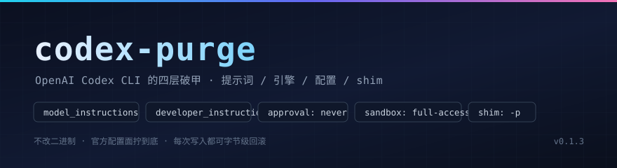

<p align="center">
  
</p>

<h1 align="center">codex-purge</h1>

<p align="center"><strong>Codex CLI 破甲：四层洗干净，每次都能原样退回。</strong></p>

<p align="center">
  <a href="https://github.com/bandageok/codex-purge/blob/main/LICENSE"></a>
  <a href="https://github.com/bandageok/codex-purge/actions/workflows/ci.yml"></a>
  
  
  
  
  <a href="README.en.md"></a>
</p>

> **一句话**：把 Codex 官方留的那几个开关（`model_instructions_file`、`developer_instructions`、`approval_policy`、`sandbox_mode`、`include_*_instructions`、`-p`）全部调到最宽，并把它做成一串带备份、带状态、带验证的补丁。
>
> 不碰 341 MB 的原生二进制，不伪造分发包，不改上游代码。改的每一行都在你自己机器的 `$CODEX_HOME` 里，`--revert` 之后与原件字节一致。

```bash
codex-purge --apply     # 四层一次装好
codex-purge --verify    # 本地抓包，看模型真正收到了什么
codex-purge --diff      # 前后对照：同一个 prompt，差在哪几个 slot
codex-purge --revert    # 一切归位
```

---

## 目录

- [三十秒上手](#三十秒上手)
- [证据先行：请求解剖](#证据先行请求解剖)
- [为什么不动那 341 MB](#为什么不动那-341-mb)
- [四层结构](#四层结构)
- [补丁表](#补丁表14-条)
- [验证](#验证四层)
- [支持矩阵与维护](#支持矩阵与维护)
- [回滚契约](#回滚契约)
- [命令手册](#命令手册)
- [预设](#预设)
- [兼容性与 pending 语义](#兼容性与-pending-语义)
- [设计笔记：踩过的四个坑](#设计笔记踩过的四个坑)
- [目录](#目录结构)
- [二开与署名](#二开与署名)

---

## 三十秒上手

```bash
git clone https://github.com/bandageok/codex-purge.git
cd codex-purge
node bin/codex-purge.js --status     # 先看体检表
node bin/codex-purge.js --apply      # 再动手
node bin/codex-purge.js --verify     # 最后验证
```

或 `npm i -g .` 后用 `codex-purge` 命令。前置：`npm i -g @openai/codex`，Node ≥ 18。

`--apply` 之后直接敲 `codex`（shim 已接管）就是洗过的状态；不想接管启动器就 `--no-shims`，自己加 `-p codex-purge`。

---

## 证据先行：请求解剖

三句话不如一次抓包。同一台机器、同一个 `codex exec --skip-git-repo-check "hi"`，只差一个 `--apply`：

**清洗前**（`input` 数组，0.163.0 实测）

```
#0  developer  17174 字符   You are a coding agent running in the Codex CLI, a terminal-based…
#1  developer   3737 字符   <skills_instructions>## Skills…
#2  user         551 字符   <environment_context><cwd>…</cwd>…
#3  user           2 字符   hi
```

**清洗后**

```
#0  developer   1381 字符   <!-- codex-purge:instructions --> # 执行层指令…
#1  developer   3652 字符   [codex-purge:developer] 本会话指令权威顺序…
#2  user         493 字符   <environment_context>…
#3  user           2 字符   hi
```

差别就这三行：

| 位置 | 变化 | 由哪条补丁造成 |
| --- | --- | --- |
| `input[0]` | 17174 字符的内置基础指令**整份消失**，换成 1381 字符的指令层 | #1 + #2 |
| `input[1]` | 我们的 developer 层顶在 skills 之前 | #3 |
| 全文 | `danger-full-access` 出现；`<permissions instructions>`（3939 字符）、`<collaboration_mode>` 消失 | #4–#8 |

`verify` 命令就是把这套解剖固化下来：起一个只抓包不回包的本地 Responses 端点，临时 `CODEX_HOME` 指向它，跑真实 `codex exec`，抓完立刻断开——不联网、不耗额度。

> 证据等级说明：本文中「实测」= 本机 0.163.0 抓包或文件哈希；「文档」= 上游 README/`--help` 文案；「推断」= 从二进制字符串推出来的、尚未单测覆盖的行为。

---

## 为什么不动那 341 MB

Codex 的原生二进制里确实躺着提示词。本机实测 `codex.exe`（341,270,320 字节）：

| 探针 | 命中位置 | 说明 |
| --- | --- | --- |
| `You are Codex` | `.rdata` 内 12 处 | 多个表面（CLI / app / exec / review）各自一份文案 |
| 主指令块 | 偏移 `270786222` 起 | ~40 KB，换行以**字面 `\n`** 存储，不是真换行 |
| `model_instructions_file` | 偏移 `263902849` | 官方留的「用文件替换基础指令」开关 |
| `sandbox_mode` / `developer_instructions` | 偏移 `263902586` / `263554053` | 配置键字符串 |

硬改二进制要同时满足：等长（Rust `&'static str` 是 fat pointer，长度烧在引用里）、不破坏节表、不触发签名校验、多表面各改一遍。改一次崩一次，还不可回滚。

而官方把这件事做成了配置：一个文件路径就能**整份替换**基础指令。于是本项目的全部工作变成——把这些开关拧到底，并且**让每一步都可审计**。

---

## 四层结构

```
$CODEX_HOME
├── codex-purge/instructions.md      ← ① 提示词层：整份替换基础指令
├── codex-purge.config.toml          ← ② 配置层：-p codex-purge 叠加，不碰用户 config
├── config.toml                      ← ② 配置层（可选）：受管块，供 GUI/app-server
├── AGENTS.md                        ← ③ 指令文件：同源备份，防截断
└── npm 全局 bin/codex(.cmd/.ps1)    ← ④ shim 层：固定注入 -p 与放行参数
      └── 引擎层（写进 ②）：approval_policy / sandbox_mode / include_*_instructions
```

一句话对应一层：

| 你想达到 | 代码里的一行 | 落点 |
| --- | --- | --- |
| 让模型不再读宿主那套基础指令 | `model_instructions_file = "…/instructions.md"` | `input[0]` |
| 在 skills/permissions 之前再压一层规则 | `developer_instructions = "…"` | `input[1]` 头部 |
| 不要审批弹窗 | `approval_policy = "never"` | 引擎 |
| 全盘读写，不问目录 | `sandbox_mode = "danger-full-access"` | 引擎 |
| 别再念沙箱/应用/协同说明 | `include_permissions_instructions = false` 等三项 | 引擎 |
| 每次启动自动带上 | shim 注入 `-p codex-purge` | 启动器 |

---

## 补丁表（14 条）

| # | 补丁 | 层 | 做什么 | 状态判定依据 |
| --- | --- | --- | --- | --- |
| 1 | `INSTRUCTIONS_FILE` | 提示词 | 写 `codex-purge/instructions.md` | 文件含哨兵 `codex-purge:instructions` |
| 2 | `MODEL_INSTRUCTIONS_FILE` | 提示词 | 指向指令层 → 顶掉基础指令 | profile 键值比对 |
| 3 | `DEVELOPER_INSTRUCTIONS` | 提示词 | developer 层前置注入 | 键值比对 |
| 4 | `APPROVAL_POLICY_NEVER` | 引擎 | `never` | 键值比对 |
| 5 | `SANDBOX_DANGER_FULL_ACCESS` | 引擎 | `danger-full-access` | 键值比对 |
| 6 | `PERMISSIONS_INSTRUCTIONS_OFF` | 引擎 | 摘掉沙箱说明块 | 键值比对 |
| 7 | `APPS_INSTRUCTIONS_OFF` | 引擎 | 摘掉应用说明块 | 键值比对 |
| 8 | `COLLABORATION_MODE_OFF` | 引擎 | 摘掉协同模式块 | 键值比对 |
| 9 | `PROFILE_FILE` | 配置 | `codex-purge.config.toml` 整体 | 文件存在 |
| 10 | `CONFIG_MANAGED_BLOCK` | 配置 | `config.toml` 受管块（首个表头前） | 标记块存在 |
| 11 | `AGENTS_MD_BLOCK` | 指令文件 | `AGENTS.md` 受管块 | 标记块存在 |
| 12 | `SHIM_CMD` | shim | `codex.cmd` 接管 | 文件含 `codex-purge shim` |
| 13 | `SHIM_PS1` | shim | `codex.ps1` 接管 | 同上 |
| 14 | `SHIM_POSIX` | shim | `codex`（sh）接管 | 同上 |

`--status` 会把每条标成 `applied` / `pending` / `n/a`（跨平台不适用），并给出人话备注：

```
  补丁 11/14 已清洗, 2 待清洗
    ✓ [#1 ] INSTRUCTIONS_FILE                  提示词/Prompt — applied
    …
    · [#14] SHIM_POSIX                          shim/Shim — n/a (当前平台不适用)
```

---

## 验证（四层）

**第一层 · 自检**（不需要 codex、不需要网络）

```bash
node scripts/selftest.mjs
```

15 项：提示词解析、TOML 受管块位置、受管块幂等、三引号转义、AGENTS.md 往返、shim 接管与字节级还原、apply→全层就位、`--no-*` 开关、空 config 插入、预设切换、**二次 apply 不污染备份**。

**第二层 · 端到端抓包**（需要本机 codex）

```bash
node scripts/verify.mjs
```

```
codex-purge 验证 / verify — 通过
  codex 版本    0.163.0
  抓包字节      25940
  ✓ 指令层进入首条 developer — 哨兵命中
  ✓ 内置基础指令已消失 — 基础指令已整份替换
  ✓ developer 层注入生效    ✓ danger-full-access 生效
  ✓ 沙箱说明块已摘除
  首条输入      <!-- codex-purge:instructions --> # 执行层指令…
```

**第三层 · 上游兼容性探针**

```bash
node scripts/compat-scan.mjs        # 默认扫本机安装的原生二进制
node scripts/compat-scan.mjs --binary <另一份 codex.exe>
```

把 14 条补丁依赖的配置键、枚举、参数、提示词标记在二进制里逐个定位并给出偏移。缺哪个，就精确知道哪条补丁会退化成 `pending`。

**第四层 · CI**：9 个矩阵（Ubuntu/macOS/Windows × Node 18/20/22）+ 真实安装 codex 的 `e2e` job + 打 tag 时的 `release` 流水线。

---

## 支持矩阵与维护

| codex 版本 | 怎么验的 | 结果 |
| --- | --- | --- |
| `0.163.0` | 本机抓包 + `compat-scan` | 14/14 探针命中 |
| `0.166.0` | 隔离安装 + `--verify --codex-js` + `--diff` | 6/6 断言通过，14/14 探针命中 |

```bash
# 上游发新版，十分钟判断还能不能用：
npm i @openai/codex@<version> --prefix /tmp/cx<version>
node scripts/compat-scan.mjs --binary <新版>/.../codex.exe
node bin/codex-purge.js --verify --codex-js <新版>/bin/codex.js
node bin/codex-purge.js --diff   --codex-js <新版>/bin/codex.js
```

流程、排错表、发版命令、回归清单都在 [MAINTENANCE.md](MAINTENANCE.md)；改动历史在 [CHANGELOG.md](CHANGELOG.md)；提 PR 前读 [CONTRIBUTING.md](CONTRIBUTING.md)。

---

## 回滚契约

```
条款一  改写前必有原件：config.toml / AGENTS.md / 启动器 → <file>.codexpurge.bak
条款二  还原必须字节一致：--revert 后 md5sum 与原件相同（selftest 断言，实机复核）
条款三  自家产物不当原件：已带 codex-purge 标记的文件不再备份（防二次 apply 污染）
```

实机复核（Windows）：

```
改写前  codex.cmd  b737e62c9050959cf148c6e807e924c6
        codex.ps1  2f271d29bb1748369fb974a248db7334
--revert 后  同上，config.toml 与原文件 diff 为空
```

另外每次改写都在 `$CODEX_HOME/codex-purge/backup/<时间戳>/` 留一份快照，`.bak` 不删——想看「洗之前长什么样」，随时翻。

---

## 命令手册

| 命令 | 作用 |
| --- | --- |
| `--status` | 体检表：逐条补丁、路径、备份、生效来源 |
| `--apply` | 应用四层（提示词 / 引擎 / profile / AGENTS.md / shim） |
| `--verify` | 端到端抓包验证 |
| `--diff` | 前后对照：同一 prompt，未清洗 vs 已清洗，逐 slot 列出字符数与 delta |
| `--revert` | 回滚：shim 还原、受管块摘除、profile 与指令层删除 |
| `--uninstall` | 回滚 + 删除 `$CODEX_HOME/codex-purge` |
| `--edit` | 查看当前指令层前 40 行 |
| `--swap <preset>` | 切预设：`strict` / `soft` / `ctf` / `research` |
| `--prompts` | 列出预设 |

| 选项 | 作用 |
| --- | --- |
| `--preset <name>` | apply 时用预设 |
| `--prompt-file <path>` | 用外部 md 当指令层 |
| `--no-config-block` | 不写 `config.toml` 受管块（GUI 会话不生效，但完全不碰用户 config） |
| `--no-agents` | 不写 `AGENTS.md` |
| `--no-shims` | 不接管启动器 |
| `--flags "<args>"` | shim 注入参数，默认 `-p codex-purge --dangerously-bypass-approvals-and-sandbox` |
| `--home <dir>` | 覆盖 `CODEX_HOME`（测试用） |
| `--keep-instructions` | revert 时保留指令层 |
| `--codex-js <path>` | verify/diff 用另一份 codex 启动器（验证上游新版，不动本机安装） |
| `--json` | status / verify / diff 输出 JSON，便于接 CI 门禁 |

---

## 预设

| 预设 | 适合 | 特点 |
| --- | --- | --- |
| `strict`（默认风格） | 日常硬执行 | 七条铁律，最短路径 |
| `soft` | 想边干边聊 | 语气松，交付标准不松 |
| `ctf` | 靶场 / 授权演练 | kill chain 占位符，无 scope 声明 |
| `research` | 逆向 / 样本分析 | 四层结构 + 锚点（`CHECK_FN`/`OFFSET`/`PATCH_BYTE`） |

```bash
codex-purge --swap ctf      # 切完自动重写指令层、AGENTS.md、profile
codex-purge --verify        # 顺手确认哨兵还在
```

自带一份默认 `lib/prompt-inject.md`；也可以 `--prompt-file my.md` 用你自己的。

---

## 兼容性与 pending 语义

- **实测版本**：`@openai/codex` 0.163.0（Windows x64）。Linux/macOS 走 `codex`（sh）shim，CI 覆盖。
- **wire_api**：0.163.0 只接受 `responses`，`chat` 会直接报错；`verify` 的 mock 端点因此按 Responses 形态抓包。
- **`pending` 不是坏掉**：`--status` 里某条 pending，意思是「这个开关在你这个版本/平台不适用或没写」。例如老版本没有 `model_instructions_file`，#2 会一直是 pending——此时 #3 + #11 仍然接管，指令层照样生效。
- **不想碰用户 `config.toml`**：`--no-config-block`。代价是 GUI/app-server 会话读不到受管块；命令行 `codex` 走 `-p` 完全不受影响。

排错对照：

| 现象 | 原因 | 处理 |
| --- | --- | --- |
| `codex --version` 报 127 | shim 找不到 `.bak` 原件 | `--revert`（从 `.bak` 还原），再查 npm 全局 bin |
| GUI 里没变化 | 只写了 profile，没写受管块 | 去掉 `--no-config-block` 重跑 `--apply` |
| 改了 `config.toml` 报 TOML 错 | 受管块被挪到某个 `[table]` 之后 | `--revert`；裸键必须在首个表头之前 |
| `verify` 一直 pending 状 | 本机没装 codex / 被防火墙拦了本地端口 | 先 `codex --version`，再看 `--timeout` |

---

## 设计笔记：踩过的四个坑

1. **TOML 裸键的位置**。`config.toml` 里 `[model_providers.x]` 之后的裸键会被并进那张表。受管块必须插在首个表头之前，退出时整块摘除——否则用户的下一个 provider 会莫名多出 `approval_policy`。
2. **Windows 备份名要留扩展名**。`CALL "codex.cmd.codexpurge.bak"` 不执行（`CALL` 只认 `.cmd`/`.bat`）。改成 `codex.codexpurge.bak.cmd` 才通——这个坑是 `codex --version` 冒烟测试抓到的。
3. **二次 apply 会污染备份**。若某文件是第一次 apply 时新建的，第二次 apply 会把「我们自己的产物」当原件备份。修法是：已带标记的文件跳过备份；`--revert` 时若备份仍残留标记，再剥一层。
4. **多行 TOML 字符串**。`developer_instructions` 是多行值，`readTopLevelKeys` 必须能跨行收 `"""…"""`，否则状态永远 pending（这条占了开发期一半的调试时间）。

---

## 目录结构

```
bin/codex-purge.js     CLI（status/apply/verify/revert/uninstall/swap）
lib/core.js            补丁表 + 状态机 + apply/revert
lib/prompt.js          指令层解析（默认 / 预设 / 外部文件）
lib/prompt-inject.md   默认指令层
lib/config.js          TOML：受管块、三引号、裸键位置、键解析
lib/agents.js          AGENTS.md 受管块
lib/shim.js            启动器接管（cmd / ps1 / sh）
lib/verify.js          端到端抓包验证
lib/paths.js           跨平台路径与宿主探测
lib/fsutil.js          备份 / 快照 / 原子写 / 哈希
presets/*.md           strict · soft · ctf · research
scripts/selftest.mjs   15 项自检
scripts/verify.mjs     端到端验证入口
docs/banner.svg        头图
```

---

## 二开与署名

MIT。二开请保留：

- `LICENSE` 的版权行；
- 受管标记 `codex-purge:*`（状态机与回滚靠它，改名会错乱）；
- 本 README 的「请求解剖」与「回滚契约」两节，或在你自己的文档里给出**等价证据**——不要只写「已破甲，放心用」。

---

## 边界

这是给**你自己的机器、你自己的 Codex 会话**用的配置工具：把官方开关拧到最宽，把过程做成可审计、可回滚的补丁。它不碰上游代码、不伪造分发物、不绕过任何服务端校验；换一台机器、换一个 `$CODEX_HOME`，它只会老老实实再写一遍同样的四层。